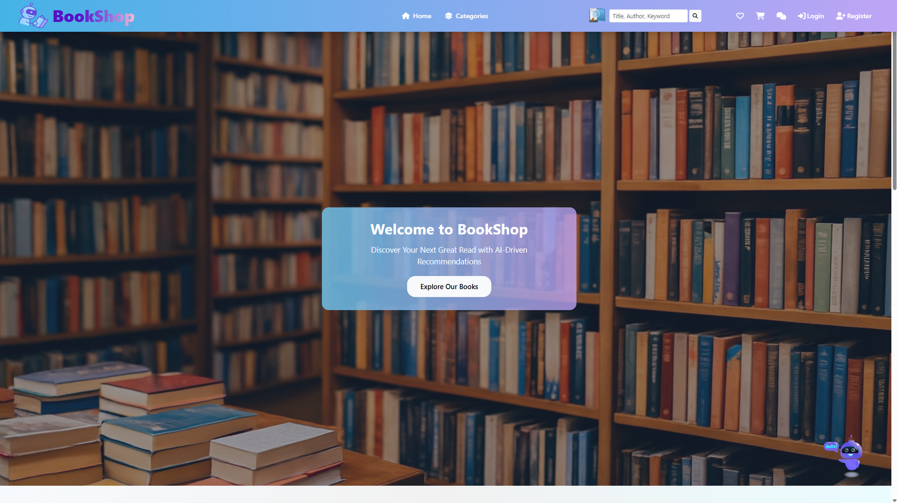
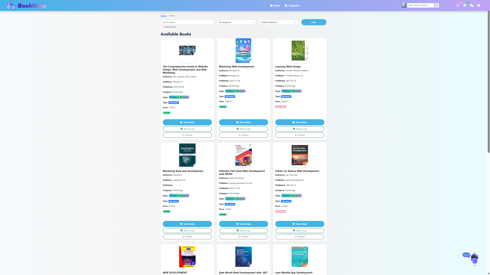

# Online Bookshop with AI Chatbot

University team project: a Django online bookshop with catalogue search, cart, wishlist, reviews, orders, and an AI-assisted chatbot.

This was a university team project at **Berliner Hochschule für Technik (BHT)**.

## Project Overview

The application supports browsing and reviewing books, guest and account-based
carts and wishlists, checkout initiation, order history, and return requests.
The chatbot returns records from the shop's catalogue. It uses OpenAI for intent
classification, sentiment analysis and preference summaries when configured;
it is not a custom-trained recommendation model.

This privacy-safe snapshot preserves the original project images, logo, category
artwork and chatbot animations. Demo catalogue data is described below.
See [asset notes](docs/ASSETS.md) and [validation scope](docs/VALIDATION.md).

## Technologies Used

- Python 3.11 and Django 5.2.18
- PostgreSQL; SQLite for a credential-free isolated demo/test setup
- Django templates, Bootstrap 5, Font Awesome and vanilla JavaScript
- OpenAI Python SDK, RapidFuzz, Stripe Checkout, Google Books and SMTP
- WhiteNoise for collected static files
- Django tests and Node.js/jsdom DOM regression tests

## Main Features

- Catalogue search across titles, authors, categories, topics and descriptions;
  category/topic/type/availability filters and pagination.
- Registration with email activation, login, profile editing and logout.
- Guest session carts/wishlists and account-based persistent carts/wishlists.
- Book reviews with validated 1–5 ratings and like/dislike actions.
- Checkout with address validation and frozen order prices. An order becomes
  paid only after server-side Stripe session verification, including ownership,
  amount, currency and payment status. These integration paths are tested with mocks.
- Order history and return requests limited to paid orders within 14 days of
  order creation, with cumulative quantity validation.
- Catalogue-based chatbot suggestions, filters, conversation history, guest/user
  ownership checks and optional preference summaries.
- Non-destructive Google Books import with timeout/status handling, plus a
  reviewed public catalogue snapshot for demonstrations without API calls.

## Screenshots

Project UI captures from the original team-project interface:





These historical captures show the original visual assets, which have also been
restored in the runnable sanitized snapshot. The wishlist and cart captures are
withheld because their footers contain unverified contact details.

## Demo

Hosted video: **Coming soon**. A future hosted demo link will be added after
privacy and rights review. The original large recording is not included.

For a local credential-free demo, use the isolated setup below. OpenAI, Stripe,
SMTP and Google Books network calls are disabled in these settings. Rule-based
chatbot catalogue suggestions remain available; checkout displays a controlled
service-disabled response instead of attempting payment.

## Setup

Prerequisites: Python **3.11**, PostgreSQL for the normal setup, and Node.js/npm
for DOM tests. Validation used Python 3.11.12 under WSL Ubuntu and PostgreSQL 14.

Create an environment and install dependencies:

```bash
python3.11 -m venv .venv
source .venv/bin/activate
python -m pip install -r requirements.txt
```

On Windows with Python 3.11 installed, use `py -3.11 -m venv .venv` and
`.venv\Scripts\Activate.ps1` instead of the first two commands.

### Isolated demo — no service credentials required

```bash
python -c "from pathlib import Path; Path('.validation').mkdir(exist_ok=True)"
python manage.py migrate --settings=myshop.test_settings
python manage.py seed_demo --settings=myshop.test_settings
python manage.py collectstatic --noinput --settings=myshop.test_settings
python manage.py runserver 127.0.0.1:8765 --settings=myshop.test_settings
```

Visit <http://127.0.0.1:8765/>. The SQLite demo database, static output and uploads
stay under ignored `.validation/`. Its randomly generated signing key and fast password hasher are
for local testing only. Registration email stays in memory; HTTP smoke tests
create their own synthetic demo account.

### Normal local setup with PostgreSQL

Create a dedicated empty PostgreSQL database and role using your local database
administration tools. Copy `.env.example` to `.env`, fill in your connection
settings, and generate a fresh Django signing key:

```bash
python -c "from django.core.management.utils import get_random_secret_key; print(get_random_secret_key())"
```

Save that value as `DJANGO_SECRET_KEY` in the ignored `.env`. Never commit it.
Keep `DEBUG=True` for local development. Console email is configured in the
example so activation messages can be inspected without SMTP credentials.

```bash
python manage.py check
python manage.py migrate
python manage.py seed_demo
python manage.py collectstatic --noinput
python manage.py runserver
```

The seed command adds **3,260 original public book records** and **15 categories**,
with **3,171 original Google Books cover URLs** and 89 original fallback-image
references. It preserves existing books and can be rerun without duplicates.
The snapshot contains only public bibliographic/catalogue fields; no accounts,
orders, reviews, uploads, original database IDs or credentials are included.
Three email addresses in book descriptions were redacted. Prices and stock
retain the original project's demonstration values.

For an optional Google Books catalogue, run `python data/import_books.py`, then
`python data/import_master_categories.py` and `python data/assign_books_to_categories.py`.
The importer preserves existing records and relationships; it can stop partway
through an import on HTTP errors or rate limits. Repeated imports skip matching
title/author/topic records. Imported prices and stock are random demo values.
These scripts use the database selected by your settings: use a demo database.

## Environment Variables

| Variable | Purpose |
| --- | --- |
| `DJANGO_SECRET_KEY` | Required fresh local signing key; no production fallback |
| `DEBUG` | Set exactly `True` for local development; defaults to false |
| `ALLOWED_HOSTS` | Comma-separated hosts; defaults to loopback/localhost |
| `DB_NAME`, `DB_USER`, `DB_PASSWORD`, `DB_HOST`, `DB_PORT` | Normal PostgreSQL connection |
| `OPENAI_API_KEY` | Optional OpenAI access; missing credentials use deterministic fallback behavior |
| `OPENAI_MODEL` | Model selection; defaults to `gpt-3.5-turbo`; live availability is unverified |
| `STRIPE_SECRET_KEY`, `STRIPE_PUBLISHABLE_KEY` | Stripe integration configuration; the server returns a hosted checkout URL |
| `EMAIL_BACKEND` | Console backend in the example; SMTP backend by default |
| `EMAIL_HOST_USER`, `EMAIL_HOST_PASSWORD` | SMTP credentials when enabled |
| `DEFAULT_FROM_EMAIL` | Configurable activation sender |

The SMTP implementation currently uses Gmail's host, port 587 and TLS.
`myshop.test_settings` disables dotenv loading and overrides external credentials.
Optional PostgreSQL validation uses `VALIDATION_DB_NAME` (must begin with
`bookshop_validation`), `VALIDATION_DB_USER` and `VALIDATION_DB_HOST`; it never
uses the normal `DB_*` settings.

## Tests

```bash
python manage.py check --settings=myshop.test_settings
python manage.py makemigrations --check --dry-run --settings=myshop.test_settings
python manage.py test --settings=myshop.test_settings --noinput
npm ci --ignore-scripts
npm test
```

With the isolated server running on port 8765, execute in another terminal:

```bash
python scripts/smoke_test.py
python scripts/verify_publication.py
```

The smoke script modifies only the isolated SQLite demo database and creates
synthetic users/reviews/orders. It exercises 21 live HTTP checks, including
expected payment safety rejections. The publication check reports file categories and problems without printing secret values.

Validation on October 15, 2026:

- Fresh migrations and Django checks passed on SQLite and PostgreSQL 14.
- 81 Django tests passed on each database backend.
- 5 JavaScript/DOM regression tests passed.
- 21 live HTTP smoke checks passed against the isolated SQLite server.
- `pip check` passed; dependency and npm audits reported no known vulnerabilities
  at validation time. This does not guarantee absence of vulnerabilities.

The earlier placeholder snapshot passed SQLite/PostgreSQL tests and HTTP smoke
checks. Current restoration results and visual-comparison scope are recorded in
[validation details](docs/VALIDATION.md). No live paid-service calls are used.

See [validation details](docs/VALIDATION.md) for scope and service limitations.

## My Contribution

I was primarily responsible for the chatbot and implemented most of its application functionality and interactive interface. My work included intent and sentiment handling, the GPT provider abstraction, catalogue-based recommendations, advanced filters, quick replies, guest-session extensions, conversation-history improvements, and cart/wishlist integration. This built on session and summarization foundations contributed by another team member.

I also implemented the order and return workflows and substantially contributed to catalogue and shopping-interface development.

## Team Project

This was a university team project at **Berliner Hochschule für Technik (BHT)**.

## Limitations

- Live OpenAI, Stripe and SMTP behavior has **not been tested** during cleanup.
  Credentials are required for those services; payment verification uses mocked
  Stripe responses in automated tests. No new paid credentials were created.
- Google Books live access is **not tested** and may be rate-limited. Import
  error handling and preservation of existing data are tested with mocks.
- The model name is configuration, not a claim of current provider availability.
  OpenAI failures fall back to catalogue/rule behavior rather than generated chat.
- Payment finalization currently depends on returning to the verified success
  page. There is no webhook reconciliation or automatic refund processing.
- Stock is a descriptive availability status, not a quantity-reservation system.
  The existing demonstration shipping/tax rules are retained.
- Guest checkout creates an account after input validation. Ordinary registration
  uses email activation; guest checkout retains its separate account-creation flow.
- PostgreSQL migrations and the full test suite passed; the live HTTP demo used
  SQLite, not a production PostgreSQL deployment.
- DOM tests are not a complete real-browser, accessibility or responsive-layout
  audit. External CDNs and cover hosts may require network access.
- Chat throttling uses Django's cache and is per browser session. Shared-cache and
  edge-level limits are needed for a multi-process public deployment.
- Original design artwork and animations are preserved. Two visibly watermarked
  category images require manual review; see [attribution](docs/ATTRIBUTION.md).
  A project-wide code license has not been selected.
